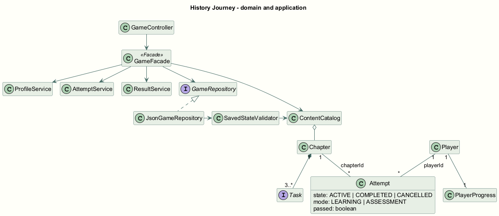
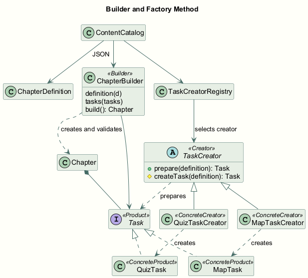
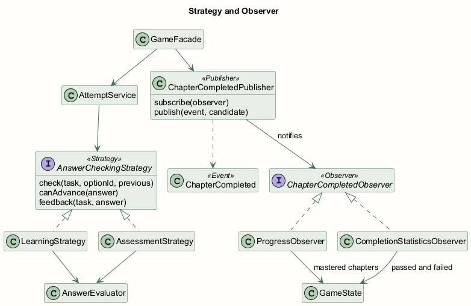
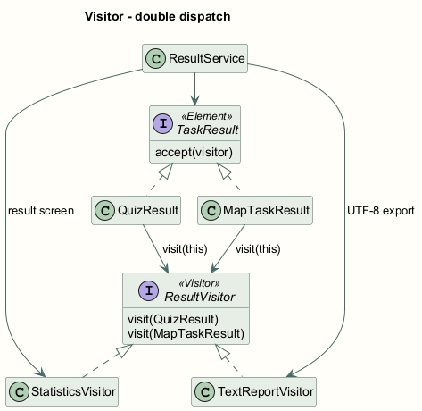
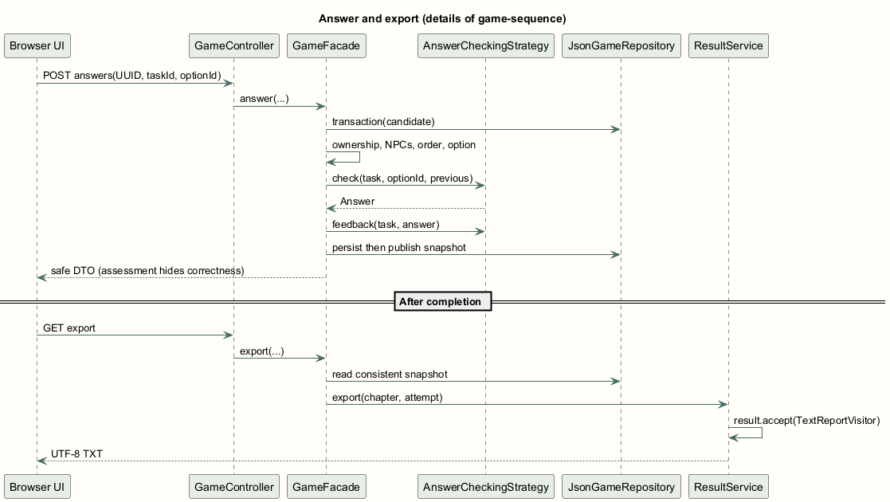
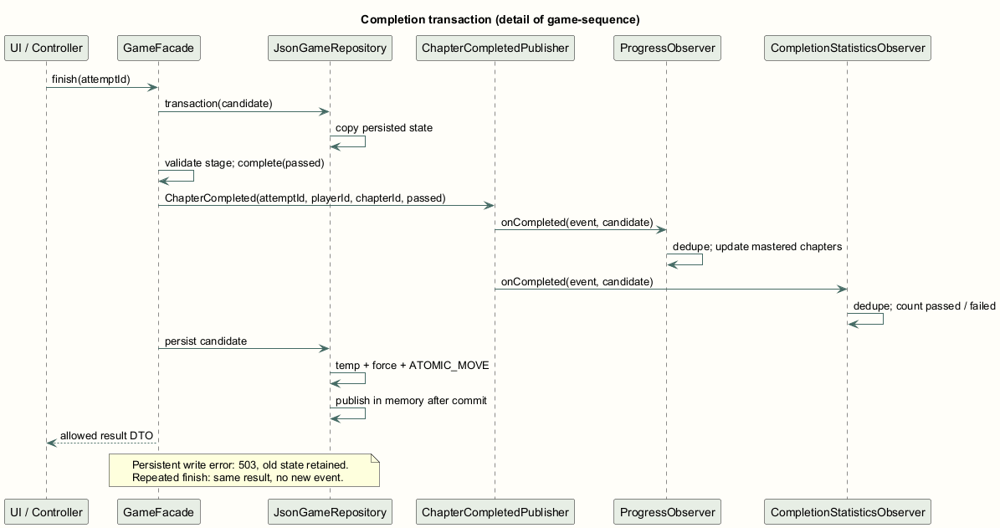

# Путешествие по истории Казахстана
Software Design Patterns · учебный проект

Бахыт Карима · Адай Аида · Казбекова Айша

Технический отчёт · 8 ноября 2026

## Introduction
Цель проекта - дать учащемуся короткий интерактивный маршрут по истории Казахстана и показать, как шесть паттернов Java образуют единую архитектуру. Пользователь создаёт профиль, выбирает режим, исследует сцену, разговаривает с жителями, выполняет задания и сохраняет итог.

Аудитория - студенты и школьники, которым полезно связать дату, место и содержание события. Образовательная игра охватывает десять глав от образования Казахского ханства до государственной независимости. Полноценную академическую историю короткий маршрут не заменяет.

Объём версии: 10 сцен, 20 вымышленных NPC, 20 вопросов и 10 заданий карты; два аватара и два режима; сохранение, продолжение, отмена, история и TXT-экспорт. Современный контур карты служит ориентиром, а не исторической границей.

При разработке кода, контента, оформления и документации использовался Codex. Фактическое использование AI и сведения об участниках приведены в разделе о вкладе.

<!-- PAGE -->
# Main Body
## Пользовательские сценарии и сущности
1. Создать профиль и выбрать героя или героиню; просмотреть карту.
2. Изменить имя и аватар существующего профиля и сохранить.
3. Выбрать доступную главу и один из двух режимов.
4. Исследовать сцену, выслушать обоих NPC, прочитать справку.
5. В обучении получить подсказку после ошибки и повторить ответ.
6. В проверке дать один ответ на каждое задание и получить оценку.
7. Завершить успешно, раскрыть название и открыть следующую главу.
8. Перезапустить Java и продолжить с сохранёнными NPC и ответами.
9. Открыть историю, результат и экспорт выбранной попытки.
10. Отменить ACTIVE-попытку с подтверждением, сохранив прогресс.
11. Освоить десять глав и экспортировать общий итог.

| Сущность | Назначение и связи |
| --- | --- |
| Player | ID, имя, Avatar; один игрок имеет несколько Attempt |
| Chapter | Порядок, скрытый заголовок, период, география, сцена, NPC, задачи и источники |
| Attempt | playerId/chapterId, Mode, State, NPC, ответы, UUID запросов, время и passed |
| Task / TaskResult | QuizTask и MapTask; QuizResult и MapTaskResult для итога |
| PlayerProgress | Множество уникальных успешно освоенных глав и обработанных событий |

ACTIVE переходит только в COMPLETED или CANCELLED. passed хранится отдельно для COMPLETED. Отмена не удаляет прошлый прогресс. Повторное прохождение увеличивает число попыток, сохраняя число уникальных глав.

<!-- PAGE -->
# Main Body
## Содержание десяти глав

| № | Событие | Период | Место сцены |
| --- | --- | --- | --- |
| 1 | Образование Казахского ханства | 1465-1466 | Долина Шу, Западное Жетысу |
| 2 | Орбулакская битва | 1643 | Орбулак, Жетысуский Алатау |
| 3 | Начало «Ақтабан шұбырынды» | 1723 | Юго-восток казахской степи |
| 4 | Восстание Кенесары Касымулы | 1837-1847 | Район Акмолинского укрепления |
| 5 | Национально-освободительное восстание | 1916 | Тургайский регион |
| 6 | Автономия Алаш и Алаш-Орда | Декабрь 1917 | Оренбург, Второй Всеказахский съезд |
| 7 | Голод в Казахстане | 1931-1933 | Собирательный аул Казахстана |
| 8 | Казахстан в годы войны | 1941-1945 | Алма-Ата (современный Алматы) |
| 9 | Первый полёт человека в космос | 12 апреля 1961 | Космодром Байконур |
| 10 | Государственная независимость Казахстана | 16 декабря 1991 | Алма-Ата, тогдашняя столица |

Контент загружается из resources/content через ContentCatalog. Даты, география и проверяемые факты подтверждены источниками S01-S10, S08b и S10b. Каждый NPC и каждое задание содержит sourceId; ссылки открываются в текущей главе.

До успешного завершения обзорные DTO, карта и история используют «Уровень N». В открытой сцене период и факты доступны как часть обучения. Правильные ответы не включены в DTO заданий. Неуспешное повторное прохождение не скрывает уже раскрытое название.

Сцена Кенесары относится к 1838 году; 1847 год сообщает позднейший рассказчик. Есен-Буга не появляется в сцене 1465-1466. Оренбург находится вне современного Казахстана и вынесен на вставку. Голод и война рассматриваются спокойно, через изучение сведений; численность жертв и спорные оценки не превращены в игровой балл.

<!-- PAGE -->
# Main Body
## Архитектура, SOLID и хранение
web принимает DTO и проверяет ввод; service выполняет use cases; model содержит сущности; content/task создают главы и задания; strategy/event/result выполняют специализированное поведение; storage фиксирует JSON. Браузер управляет отображением и движением, сервер - ответами, допуском, прогрессом и итогом.

SRP: отдельные ProfileService, AttemptService, ResultService и JsonGameRepository. OCP: новый подписчик или посетитель расширяет обработку. LSP: продукты Task и стратегии соблюдают интерфейсные контракты. ISP: небольшие GameRepository, ResultVisitor и ChapterCompletedObserver. DIP: GameFacade зависит от интерфейса хранилища. Ограничение: фасад пока сам собирает небольшие сервисы и подписчиков.

JSON находится вне JAR, в конфигурируемой папке data. Снимок версии 1 содержит профили, попытки, NPC, ответы, прогресс, статистику и дедупликацию. SavedStateValidator сверяет ссылки, порядок ответов, итог и события с игровым контентом; несогласованный JSON не становится текущим состоянием. Первый запуск создаёт demo; последующие загружают сохранение. Позиция героя после продолжения - безопасная стартовая точка.

Транзакция: создать копию состояния, применить действие и подписчиков, записать временный файл, force, ATOMIC_MOVE, затем опубликовать в памяти. Краткие AccessDenied на Windows повторяются ограниченно; постоянная ошибка возвращает 503 и оставляет старый снимок. Повреждённый файл не перезаписывается: пользователь получает инструкцию восстановить или переименовать его и перезапустить сервер.

Модель доверия локальная: сервер слушает 127.0.0.1, аутентификации нет. Выбор профиля не является защитой от владельца компьютера. Принадлежность попытки, порядок заданий, посещение NPC и доступ к главе проверяются сервером; координаты Canvas не удостоверяются API. Для одной папки данных поддерживается один Java-процесс.

<!-- PAGE -->
# Main Body
## Обязательная таблица паттернов
Все шесть паттернов реализованы в Java и используются в игровых операциях. В таблице указаны ответственные участники по распределению тем; фактическое происхождение кода раскрыто в разделе о вкладе.

| Pattern | Problem it solves | Main classes/interfaces | How to demonstrate it | Responsible student |
| --- | --- | --- | --- | --- |
| Builder | Согласованное создание главы | ChapterBuilder, ChapterDefinition, Chapter | Запуск: загрузка 10 глав; неверная конфигурация отклоняется | Бахыт Карима |
| Factory Method | Разные продукты заданий | TaskCreator, QuizTaskCreator, MapTaskCreator, Task | Два вопроса и карта одной главы | Бахыт Карима |
| Facade | Координация игрового действия | GameFacade, ProfileService, AttemptService, ResultService | Начать, поговорить, ответить, завершить | Адай Аида |
| Strategy | Взаимозаменяемые правила ответов | AnswerCheckingStrategy, LearningStrategy, AssessmentStrategy | Одна ошибка в двух режимах | Адай Аида |
| Observer | Реакция на завершение | ChapterCompletedPublisher, ChapterCompletedObserver, ProgressObserver, CompletionStatisticsObserver | Успех открывает главу; неуспех учитывается | Казбекова Айша |
| Visitor | Статистика и экспорт разных результатов | TaskResult, QuizResult, MapTaskResult, ResultVisitor, StatisticsVisitor, TextReportVisitor | Экран результата и TXT | Казбекова Айша |

Два порождающих, один структурный, три поведенческих паттерна. Framework-механизмы не засчитываются как собственные реализации. Ограничения: Visitor требует обновить все visit при новом типе результата; синхронные подписчики работают только внутри снимка; Facade нужно защищать от чрезмерного роста.

<!-- PAGE -->
# Main Body
## Java: Builder, Factory Method и Strategy
ContentCatalog читает определения, реестр готовит Task, Builder создаёт неизменяемый Chapter. Нельзя обойти проверку ссылок на NPC, источники и допустимые варианты.

```java
result.add(new ChapterBuilder().definition(d)
    .tasks(d.tasks().stream().map(registry::prepare).toList())
    .build());
```

TaskCreator.prepare содержит общий процесс и вызывает переопределяемый createTask. Это отличает Factory Method от одного класса с названием Factory.

```java
public final Task prepare(TaskDefinition d) {
    // Validation of fields, options and coordinates
    return createTask(d);
}
protected abstract Task createTask(TaskDefinition d);
```

Выбранный режим сохранён в Attempt. Стратегия определяет повтор, продвижение и раскрытие обратной связи; AnswerEvaluator повторно использует сравнение с серверным ответом.

```java
var strategy = attempts.strategy(a);
var answer = strategy.check(task, optionId,
                            a.answers.get(taskId));
a.answers.put(taskId, answer);
var feedback = strategy.feedback(task, answer);
```

LearningStrategy позволяет продолжить только после правильного ответа. AssessmentStrategy продвигает после любого единственного ответа, возвращая лишь подтверждение приёма. Полная оценка появляется после finish. Сервер сам проверяет текущий taskId и optionId.

<!-- PAGE -->
# Main Body
## Java: Facade, Observer и Visitor
GameFacade координирует use case внутри repository.transaction. Завершение публикует событие только при реальном ACTIVE → COMPLETED; повтор finish возвращает прежний результат.

```java
a.complete(a.answers.values().stream()
    .allMatch(Attempt.Answer::correct));
publisher.publish(new ChapterCompleted(
    a.id, a.playerId, a.chapterId, a.passed), s);
```

ProgressObserver раскрывает главу только при passed=true, CompletionStatisticsObserver считает любой результат. Обработанный attemptId предотвращает повторное начисление. Подписчики меняют тот же кандидат, который сохранится вместе с попыткой.

```java
if (!stats.processedEvents.add(event.attemptId())) return;
stats.completed++;
if (event.passed()) stats.passed++; else stats.failed++;
```

QuizResult и MapTaskResult реализуют TaskResult.accept. Тип this выбирает перегрузку visit, а реализация посетителя определяет действие - двойная диспетчеризация.

```java
public void accept(ResultVisitor visitor) {
    visitor.visit(this);
}
var visitor = new StatisticsVisitor();
details.forEach(r -> r.accept(visitor));
```

StatisticsVisitor считает задания, правильные окончательные ответы, число ответов и ошибок. TextReportVisitor пишет вопрос, выбранный/правильный вариант, объяснение и sourceId; для карты также координаты. Оба посетителя реально вызываются ResultService для результата и TXT.

<!-- PAGE -->
# Main Body
## Тестирование и фактические результаты
Контрольный Maven verify: 48 тестов JUnit, 0 failures, 0 errors, 0 skipped. Отдельный process_smoke.py: 62 HTTP/процессных проверок, включая настоящий перезапуск Java. Полная таблица входов, шагов, ожиданий и результатов находится в docs/TEST_SCENARIOS.md.

| Проверка | Наблюдаемый результат | Статус |
| --- | --- | --- |
| Все 10 глав, оба режима | 9 открытий и финал 10/10 | Passed Java/API |
| Обучение: ошибка и повтор | 3 задания, 4 ответа, 1 ошибка | Passed |
| Проверка: один неверный | COMPLETED, passed=false, история сохранена | Passed |
| Повтор UUID / finish / события | Без повторного ответа или начисления | Passed |
| Перезапуск отдельного процесса | Те же профиль, аватар, NPC, следующий вопрос | Passed |
| Ошибка записи / corrupt JSON | Откат и 503; исходный файл сохранён | Passed |
| Пустое имя, чужая попытка, закрытая глава | 400/404/409 без изменения состояния | Passed |
| Оба Visitor и продукты фабрики | Quiz/Map, счётчики и UTF-8 TXT | Passed |
| Логика интерфейса | 20 unit-проверок ввода, UUID, фокуса и заданий | Passed, mock DOM/Canvas |
| Достижимость всех NPC | BFS достигает 20 NPC с коллизиями | Passed, геометрия |
| Ручное управление и экран скачивания | Браузерный инструмент заблокирован | Not run |

Проверка геометрии не заменяет ручное прохождение сцены. Повторный process smoke после диагностики краткой блокировки OneDrive подтвердил все 62 проверки; обработка постоянного отказа записи проверена отдельным тестом.

Запуск: ./mvnw.cmd verify; python tools/process_smoke.py --java <JDK17>/bin/java.exe. JavaScript: node --check src/main/resources/static/app.js. Тесты хранилища используют изолированные временные папки.

<!-- PAGE -->
# Main Body
## Источники, инструменты и вклад
Исторические факты: Qazaqstan tarihy по главам 1-5 и 8; публикация К. С. Алдажуманова о голоде; GOV.KZ по Алаш, космическому полёту и независимости; первичный текст закона от 16 декабря 1991 в ИПС Әділет. Отдельная публикация «Вклад Казахстана в Победу» подтверждает работу тыла. Полные URL, даты доступа и ограничения приведены в docs/HISTORICAL_SOURCES.md.

Карта: Natural Earth v5.1.2, public domain; локально извлечена геометрия Казахстана. Canvas/SVG-персонажи, сцены и интерфейсные тексты созданы заново. Системные шрифты отдельно не распространяются. Статьи, фотографии, логотипы и оформление исторических порталов не копировались.

Инструменты: Microsoft OpenJDK 17.0.18, Maven Wrapper / Maven 3.9.12, Spring Boot 3.5.7, JUnit Jupiter 5.12.2, HTML/CSS/JavaScript, Python 3.14, PlantUML 1.2025.10, ReportLab и Apache PDFBox 3.0.5. Целевой Java release - 17; игра после сборки не требует сети.

Фактическая реализация новых файлов выполнена Codex с AI-помощью. Закреплённые темы: Бахыт Карима - Builder/Factory Method, Адай Аида - Facade/Strategy, Казбекова Айша - Observer/Visitor. Личный код, самостоятельные прогоны и защита участников пока не подтверждены. Реальная Git-история отражает этапы этой сессии и не имитирует три недели студенческой разработки.

## Проверка интерфейса
Локальный сервер успешно отдаёт HTML, CSS, JavaScript и SVG-ресурсы. В заключительном цикле повторно выполнена попытка открыть игру через браузер, но инструмент сообщил «browser access host is unavailable». Поэтому ручное UI-прохождение и реальные скриншоты имеют статус Not run. Тесты с макетами DOM и Canvas отдельно проверяют обработку ввода и не считаются браузерной проверкой. Изображения далее показывают UML приложения.


<!-- PAGE -->
# Main Body
## Проверенные источники
Дата доступа ко всем публикациям: 8 ноября 2026. Факты пересказаны своими словами; изображения и полные статьи не копировались.

### S01 · Образование Казахского ханства
Qazaqstan tarihy

[https://e-history.kz/ru/projects/show/23181](https://e-history.kz/ru/projects/show/23181)

### S02 · Орбулакская битва
Qazaqstan tarihy

[https://e-history.kz/ru/educational-materials/show/12473](https://e-history.kz/ru/educational-materials/show/12473)

### S03 · Начало «Ақтабан шұбырынды»
Qazaqstan tarihy

[https://e-history.kz/media/scorm/377/text/text.htm](https://e-history.kz/media/scorm/377/text/text.htm)

### S04 · Восстание Кенесары Касымулы
Qazaqstan tarihy

[https://e-history.kz/ru/history-of-kazakhstan/show/9190](https://e-history.kz/ru/history-of-kazakhstan/show/9190)

### S05 · Национально-освободительное восстание
Qazaqstan tarihy

[https://e-history.kz/ru/history-of-kazakhstan/show/9215](https://e-history.kz/ru/history-of-kazakhstan/show/9215)

### S06 · Автономия Алаш и Алаш-Орда
GOV.KZ

[https://www.gov.kz/org/mfa-zagreb/press/article/details/74554](https://www.gov.kz/org/mfa-zagreb/press/article/details/74554)


<!-- PAGE -->
# Main Body
## Проверенные источники · продолжение
Дата доступа ко всем публикациям: 8 ноября 2026. Факты пересказаны своими словами; изображения и полные статьи не копировались.

### S07 · К. С. Алдажуманов. Голод 1931-1933 годов в Казахстане: проблемы истории и методологии
Qazaqstan tarihy

[https://e-history.kz/upload/iblock/5bc/5bc5ff1e929a9b55145219416553b659.pdf](https://e-history.kz/upload/iblock/5bc/5bc5ff1e929a9b55145219416553b659.pdf)

### S08 · Казахстан в годы войны
Qazaqstan tarihy

[https://e-history.kz/ru/history-of-kazakhstan/show/9266](https://e-history.kz/ru/history-of-kazakhstan/show/9266)

### S08b · Вклад Казахстана в Победу
Qazaqstan tarihy

[https://e-history.kz/ru/news/show/28638](https://e-history.kz/ru/news/show/28638)

### S09 · Первый полёт человека в космос
GOV.KZ

[https://www.gov.kz/memleket/entities/mfa/press/news/details/185476?lang=ru](https://www.gov.kz/memleket/entities/mfa/press/news/details/185476?lang=ru)

### S10 · Государственная независимость Казахстана
GOV.KZ

[https://www.gov.kz/org/culture-kokshetau/press/news/details/1125430?lang=ru](https://www.gov.kz/org/culture-kokshetau/press/news/details/1125430?lang=ru)

### S10b · О государственной независимости Республики Казахстан. Конституционный закон от 16.12.1991
ИПС Әділет

[https://adilet.zan.kz/rus/docs/Z910004400_](https://adilet.zan.kz/rus/docs/Z910004400_)

Карта: [Natural Earth - Terms of Use](https://www.naturalearthdata.com/about/terms-of-use/) (public domain). Технологии: [Spring Boot 3.5, Java 17+](https://docs.spring.io/spring-boot/3.5/system-requirements.html), [Maven Wrapper](https://maven.apache.org/wrapper/), [JUnit 5.12.2](https://docs.junit.org/5.12.2/user-guide/). Ограничения источников и поддерживаемые факты описаны отдельно в HISTORICAL_SOURCES.md.

<!-- PAGE -->
<!-- LANDSCAPE -->
# Main Body · UML 1
## Сущности и слои приложения

Общая схема соответствует финальным Java-классам. Более подробные участники паттернов показаны на следующих схемах. Редактируемый исходник: docs/uml/architecture.puml; векторная версия: architecture.svg.

<!-- PAGE -->
<!-- LANDSCAPE -->
# Main Body · UML 2
## Builder и Factory Method

ContentCatalog использует ChapterBuilder и TaskCreatorRegistry. Общая подготовка в абстрактном TaskCreator вызывает фабричный метод конкретного создателя. Исходник: docs/uml/creational.puml.

<!-- PAGE -->
<!-- LANDSCAPE -->
# Main Body · UML 3
## Strategy и Observer

AttemptService выбирает стратегию по Mode, а GameFacade публикует завершение двум подписчикам. Обе реакции записываются с Attempt в одном снимке GameState. Исходник: docs/uml/behavioral.puml.

<!-- PAGE -->
<!-- LANDSCAPE -->
# Main Body · UML 4
## Visitor и результаты

accept выбирает перегрузку visit для QuizResult или MapTaskResult. StatisticsVisitor используется экраном результата, TextReportVisitor - экспортом. Исходник: docs/uml/visitor.puml.

<!-- PAGE -->
<!-- LANDSCAPE -->
# Main Body · UML 5
## Ответ и экспорт результата

Полная последовательность: docs/uml/game-sequence.puml и game-sequence.svg. Для читаемости в отчёте приведены два фрагмента. Все проверки ответа выполняются сервером; до finish режим проверки не раскрывает правильность.

<!-- PAGE -->
<!-- LANDSCAPE -->
# Main Body · UML 6
## Завершение и согласованное сохранение

Событие содержит ID попытки, профиля, главы и passed. Подписчики дедуплицируют attemptId. Ответ клиенту отправляется после фиксации снимка; постоянная ошибка записи оставляет прежнее состояние.

<!-- PAGE -->
# Conclusion
В проекте реализованы десять исторических глав. Игрок управляет персонажем и разговаривает с NPC, выполняет вопросы и задания на карте. Для обработки ответов используется Strategy. После успешного прохождения обновляется прогресс. Результат можно экспортировать в текстовый файл. Java-тесты и проверки отдельных процессов подтверждают правила игры, девять переходов, итог 10/10, восстановление и обработку ошибок.

Подготовлены README, PDF-отчёт и его редактируемый исходник, UML, тесты, исполняемый JAR и ZIP исходников. Комплект проверяется сборкой и запуском из чистой распаковки; результат приведён в docs/verification/RELEASE_CHECK.md. Отдельные материалы подготовки к защите, упражнения, планы и промежуточные файлы исключены из комплекта.

Оставшееся техническое ограничение - ручной UI-прогон, мобильный вид и реальные скриншоты не проверены из-за недоступности браузерного инструмента. Репозиторий проекта подключён к GitHub; история отражает фактические изменения. Самостоятельный вклад участников и результаты личной защиты должны подтверждаться реальной работой и проверкой преподавателя.

# Future Work
Развитие контента: дополнительные источники, педагогическая экспертиза формулировок, новые главы и доступная навигация. Развитие архитектуры: дополнительные стратегии проверки, новые типы заданий, более гибкая сборка зависимостей фасада и хранилище для нескольких пользователей.

Адаптивные задания и исторический AI-помощник возможны только как последующее развитие: проверенные источники, явное отделение реконструкций, проверяемые ссылки и контроль ответов преподавателем. В текущей игре AI-персонажей, генерации ответов и адаптивного обучения нет.

Оценка приложения, допустимости AI-помощи и личной защиты остаётся за преподавателем. Неподтверждённые сведения о самостоятельном написании кода в отчёте не заявляются.
